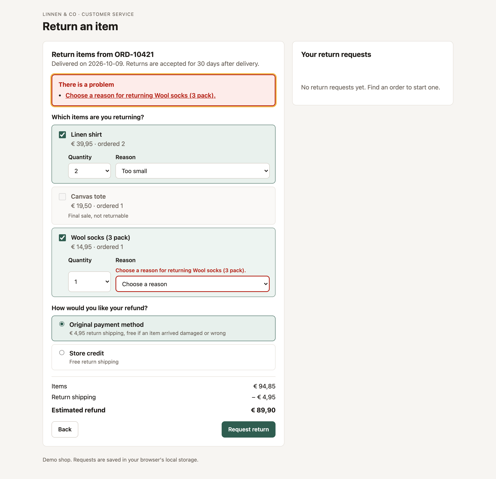
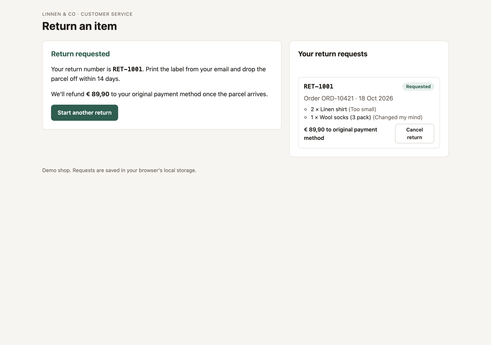

# Returns Request App

A customer-facing returns flow for a small web shop. Customers look up an order, choose which items to send back and why, see the refund estimate update as they go, and can cancel a request afterwards. A fake API saves to local storage with a short delay, so loading, failure and retry states show up the way they would against a real backend.

**Live demo:** https://takeshisan19921.github.io/returns-request-app/





## Try it

| Order | Email | What it shows |
| --- | --- | --- |
| `ORD-10421` | `sanne@example.com` | Returnable order with one final sale item |
| `ORD-10388` | `daan@example.com` | Delivered more than 30 days ago |
| `ORD-10455` | `emma@example.com` | Not delivered yet |
| `ORD-99999` | any | The service is down |

## Business rules

- Items can be returned for 30 days after delivery. Day 30 is allowed and day 31 is not, and a test covers that boundary.
- Final sale items and undelivered orders can't be returned. The disabled checkbox says why through `aria-describedby`.
- Units already in an open return can't be returned twice. Cancelling the return frees them again.
- Return shipping (€ 4,95) is charged once per parcel, only for refunds to the original payment method, and waived when any item arrived damaged or wrong.
- "Arrived damaged" and "Other" need a short description.

## Decisions worth explaining

- **Validation runs twice.** The form validates for instant feedback, and the API validates again before saving, because the client's list of existing returns can be stale.
- **Submissions are idempotent.** Each form gets a key. If a request times out after the server saved it, the retry gets the saved request back instead of creating a duplicate.
- **Unreadable saved data is an error, not an empty list.** If local storage holds corrupted JSON, the app shows a retry option and refuses to write. Treating it as empty would overwrite the customer's requests on the next save.
- **One message for a wrong number or a wrong email.** The lookup form can't be used to find out which order numbers exist.
- **Money is stored in cents** and only formatted at display time.

## Accessibility

Submitting with errors moves focus to an error summary whose links jump to each field. Every field ties its hint and error to the control with `aria-describedby` and sets `aria-invalid`. Focus moves to the new heading when the step changes, results are announced through live regions, and the layout collapses to one column on small screens.

## Tech

React 19, TypeScript (strict), Vite, Vitest and Testing Library. No form or UI libraries.

## Run it

```sh
npm ci
npm run dev      # http://localhost:5173
npm test         # rules, API and UI tests
npm run build    # typecheck + production build
```

## Project structure

```
src/
  lib/          return rules, fake API, sample orders (+ unit tests)
  components/   LookupForm, ReturnForm, Confirmation, ReturnsList, ErrorSummary, fields
  App.tsx       step state and the request list (+ end-to-end UI tests)
```

